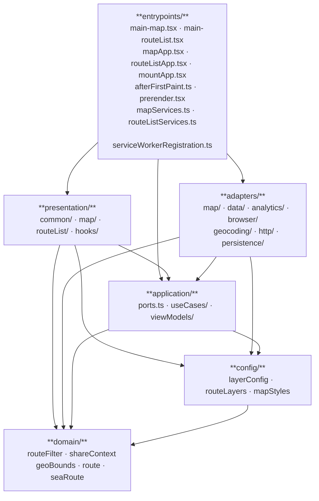

# おでかけ航路マップ 仕様書

## 1. 文書の目的

この文書はおでかけ航路マップの現行仕様を Spec-Driven Development 風に整理し、機能改修時の影響確認と回帰テストの基準として利用する設計書である。

主な用途は以下の通り。

- 仕様の基準線を明文化する
- 改修時に確認すべき振る舞いを明確にする
- 画面、データ、状態管理、外部依存の関係を把握しやすくする
- 手動テスト観点を漏れにくくする

## 2. 対象範囲

対象は Cloudflare Pages 上で配信される静的 Web アプリケーション全体。

- マップ画面: index.html
- 航路一覧画面: routeList.html
- PWA 関連: public/manifest.json, public/service-worker.js
- データ表示ロジック: src 配下の React + TypeScript モジュール群
- 航路データ: `https://pmtiles.searoute.info/` から配信する PMTiles と JSON
- 港湾データ: public/data/portData.geojson
- AI・クローラー向け出力: public/llms.txt、ビルド時に生成する llms-full.txt、航路一覧の構造化データ、public/404.html

対象外。

- 航路データ作成ツールの詳細仕様
- データ入力ワークフロー
- サーバーサイド処理

## 3. システム概要

本サイトは日本国内外の旅客船・フェリー航路情報を地図上で探索できる静的 Web アプリである。利用者は地図上の航路や港湾をクリックして詳細情報を確認し、外部の時刻表や公式サイトへ遷移できる。

主要な利用シナリオは以下。

- 地図上で航路を探す
- 航路の事業者名、航路名、運行頻度、備考、船名を確認する
- 航路の公式サイトや時刻表を開く
- 港湾位置を地図上で確認する
- 一覧ページで航路を検索する
- スマートフォンで PWA として利用する

## 4. 画面構成

### 4.1 マップ画面

対象ファイル。

- index.html
- src/entrypoints/main-map.tsx / src/entrypoints/mapServices.ts
- src/presentation/map/MapPage.tsx（ルートコンポーネント）
- src/presentation/map/DetailDrawer.tsx / detailDrawerController.ts / DrawerBody.tsx
- src/presentation/map/HamburgerMenu.tsx / LayerControl.tsx / RouteFilterControl.tsx
- src/presentation/map/ContextMenu.tsx / mapPointerInteractions.ts / touchPanelToggle.ts
- src/presentation/common/（InfoWindow / PrivacyPolicyWindow / CookieBanner / toast / loadingIndicator）
- src/adapters/map/mapFactory.ts / controlContainer.ts / geoJsonLayerAdapter.ts / pmtilesLayerAdapter.ts / layerManager.ts
- src/config/layerConfig.ts

主要 UI 要素。

- MapLibre GL JS ベースの地図
- ベースマップ・オーバーレイ・データレイヤー切替 UI
- 詳細ドロワー
- 検索ボックス
- ハンバーガーメニュー
- コンテキストメニュー
- 設定ウィンドウ
- 情報ウィンドウ
- ローディング表示

### 4.2 航路一覧画面

対象ファイル。

- routeList.html
- src/entrypoints/main-routeList.tsx / src/entrypoints/routeListServices.ts
- src/presentation/routeList/RouteListPage.tsx
- src/application/viewModels/routeListViewModel.ts
- src/adapters/data/routeListRepository.ts
- src/application/routeListSnapshot.ts（埋め込みデータの直列化・復元）
- src/application/useCases/loadRouteListTables.ts（ビルド時の一覧データ取得）
- src/application/routeListPublication.ts（JSON-LD・llms-full.txt の生成）
- src/entrypoints/prerender.tsx（ビルド時の描画とデータ取得）

主要 UI 要素。

- 国内航路一覧テーブル
- 国際航路一覧テーブル
- 韓国国内航路一覧テーブル
- キーワード検索フォーム
- リセットボタン

## 5. データモデル

### 5.1 航路データ

航路データは PMTiles と詳細 JSON の組み合わせで構成される（設定は src/config/routeLayers.ts）。

- PMTiles: 線形データと最小限の属性を保持する。4 種類の航路を 1 つのファイル `https://pmtiles.searoute.info/searoute.pmtiles` に収め、source-layer で分ける
- 詳細 JSON: routeId ごとに 1 ファイル（`https://pmtiles.searoute.info/details/<フォルダ>/<routeId>.json`）。フォルダは source-layer 名、datasetName の順に試し、取得できなければ空の詳細として扱う
- 一覧用 JSON: 航路一覧画面が読み込む（`https://pmtiles.searoute.info/lightweight/<source-layer>.json`。期間限定航路は一覧に含めない）

主なデータセット。

| レイヤー ID | source-layer | datasetName |
|---|---|---|
| geojson_sea_route | seaRoute | seaRoute |
| geojson_international_sea_route | seaRoute_international | internationalSeaRoute |
| geojson_KR_sea_route | seaRoute_KR | seaRouteKR |
| geojson_limited_sea_route | seaRoute_limited | limitedSeaRoute |

主なプロパティ。

- routeId: 航路識別子
- lineId: 航路区間識別子
- businessName: 事業者名
- routeName: 航路名
- portName1, portName2: 区間の両端港名
- color: 航路表示色
- freq: 線幅計算用の頻度指標
- freqInfo: 運行頻度表示文言
- info: 補足情報
- shipName: 船名一覧
- url: 時刻表または公式サイト URL
- note: 状態属性

### 5.2 note の意味

- null または未設定: 通常航路
- season: 季節運航
- suspend: 運休・休止中

この note 値は表示スタイル、一覧の行スタイル、表示フィルターに影響する。

### 5.3 港湾データ

港湾データは public/data/portData.geojson（配信時は ./data/portData.geojson）を使用する。主なプロパティは港名と補足情報である。

## 6. アーキテクチャ概要

### 6.1 技術要素

- 配信: Cloudflare Pages
- 実装方式: React 19 + TypeScript（strict）、Vite 8 によるマルチページビルド（index.html / routeList.html）
- 地図: MapLibre GL JS 6.18.0（npm `maplibre-gl`。ワーカーは `?worker&url` でバンドルし setWorkerUrl で指定）
- タイル: PMTiles 4.5.0（npm `pmtiles`）
- 検索補助: Maplibre Geocoder 1.9.4（npm `@maplibre/maplibre-gl-geocoder`）+ Nominatim
- スタイル: Tailwind CSS 4（`@tailwindcss/vite`）と独自 CSS（public/css/）
- アイコン: Font Awesome Free 7.3.1（npm `@fortawesome/free-solid-svg-icons` / `@fortawesome/free-brands-svg-icons`）をインライン SVG で描画
- PWA: manifest.json と service-worker.js
- 計測: Google Analytics

### 6.2 モジュール責務

依存方向（内向きのみ。`npm run lint` の eslint-plugin-boundaries で検査）。

- presentation は adapters を参照しない。地図ページが必要とするサービスは `presentation/map/mapPageServices.tsx` の `MapPageServices`（地図操作は MapLibre 非依存の `MapHandle`）として宣言し、entrypoints が実装して React Context（`MapServicesProvider`）で注入する。
- MapLibre のコントロール（ハンバーガー・レイヤー・航路フィルター）は adapters の `ContainerControl` が空のコンテナを地図へ追加し、React がポータルで中身を描画する。
- ビルド時プリレンダリング（SSG）: vite.config.ts の `searoute-prerender` プラグインがクライアントビルド後に `src/entrypoints/prerender.tsx`（react-dom/server の renderToString）を実行し、各ページの静的マークアップとビルド番号を `dist/*.html` の `#app` に埋め込む。クライアントは `hydrateRoot`（開発サーバーでは空のため `createRoot`）。地図・データ取得は副作用で実行するため、プリレンダリング結果は旧版の静的 body と同等（tests/entrypoints/prerender.test.tsx で旧版 HTML と比較）。
- 航路一覧のビルド時取得: プラグインは `loadPrerenderRouteTables`（lightweight JSON を取得、1 件でも失敗したらビルド失敗）で得た航路データを routeList.html の `#app`（全行）・`` が含まれても HTML が壊れないようにする
- llms.txt: サイト概要と主要ページへのリンク（public/llms.txt を手で管理）。llms-full.txt へのリンクを含める
- llms-full.txt: ビルド時に一覧用 JSON から生成する Markdown。カテゴリ（国内航路 / 国際航路 / 韓国国内航路）ごとに `- 事業者｜航路名（船名）［運航情報］: 地図URL / 公式: URL` を並べる（無い項目は省略、改行などの空白は 1 つの空白にまとめ、事業者名と航路名が両方空の行は出さない）。末尾に、最新情報は公式を優先する旨の注意書きを置く
- 404.html: 存在しない URL に HTTP 404 を返す（Cloudflare Pages は 404.html が無いと全 URL に 200 で index.html を返し、ソフト404 になる）。外部 CSS / JS に依存しない自己完結の静的ページで、`noindex`、地図と航路一覧へのリンクを持つ。sitemap.xml には含めない

設計判断。

- 生成方式はビルド時取得（SSG）とした。航路データの更新頻度が低いため。更新頻度が上がった場合は、Cloudflare Pages Functions でリクエスト時に差し込む方式へ移行できるよう、変換処理は application 層の純関数にしてある
- 生成物は searoute.info 上に置く（pmtiles.searoute.info に置くと評価が別ドメインに付くため）
- ai-catalog.json / ard.json（Agentic Resource Discovery）は作らない。エージェントが呼び出せる API や MCP サーバーを公開していないため。公開する場合は両方を置く

受け入れ条件。

- 本番の routeList.html に航路名・`id="route-list-data"`・`"ItemList"` が含まれる
- /llms-full.txt が 200 で全航路を返す
- 存在しない URL（例: /.well-known/ai-catalog.json）が 404 を返す
- sitemap.xml に 404.html が含まれない

### 7.20 OPS-01 航路データ更新とビルド

目的。

R2 の航路データが更新されたら、ビルド時に埋め込んだ一覧データも自動で更新する。また、取得に失敗した状態のまま空の一覧を公開しない。

期待動作。

- ビルド時の取得: vite.config.ts の `searoute-prerender` プラグインが `loadPrerenderRouteTables` を呼ぶ。一覧用 JSON 3 件（`ROUTE_LIST_TABLE_CONFIGS`）を、CDN キャッシュを避けるクエリ `?v=<時刻>` 付きで、1 件あたり 30 秒のタイムアウトで取得する
- 次のいずれかでビルドを失敗させる（Cloudflare Pages では前回のデプロイが残る）: 取得失敗（HTTP エラー・タイムアウト）、データが空（`航路データが空です: <URL>`）
- `SEAROUTE_SKIP_ROUTE_DATA=1` のときは取得・埋め込み・llms-full.txt の生成を行わない（E2E 用。playwright.config.ts の webServer で指定）
- 自動再ビルド: searoute-pmtiles の deploy-r2.yml は、`geojson/` または `details/` に変更があると lightweight JSON を作り直して R2 へアップロードし、最後に Cloudflare Pages の Deploy Hook（GitHub Secret `CF_PAGES_DEPLOY_HOOK`、main ブランチ）を呼ぶ。Secret が未設定なら警告のみで失敗にしない
- develop などのプレビューは Cloudflare Access で保護されているため、外部からの確認はできない（ログインしたブラウザで確認する）

受け入れ条件。

- R2 の一覧用 JSON を更新すると、本番の routeList.html と llms-full.txt に反映される
- 一覧用 JSON が取得できない・空のとき、ビルドが失敗する

## 8. 状態管理

状態は Runtime（ViewModel）と Cookie 永続化に分けて管理する。

Runtime 状態（主要）。

- mapViewModel: baseMap, enabledLayers
- routeFilterViewModel: status / carriage フィルター状態
- routeListViewModel: table 読み込み状態、検索クエリ
- drawerViewModel: drawer.type, drawer.isOpen, selectedRoute, coordinate, context

Cookie で以下を保持する。

| キー | 内容 | 保持期間 |
|---|---|---|
| currentMap | ベースマップ ID | 30 日 |
| currentLayer | 表示中レイヤー ID のカンマ区切り | 30 日 |
| mapCenter | 地図中心座標 | 30 日 |
| mapZoom | 地図ズーム値 | 30 日 |
| routeFilters | 航路フィルター状態 JSON | 365 日 |
| showSuspendedRoutes | 休止中航路表示フラグ | 365 日 |
| cookieConsent | Cookie バナーを閉じたこと（アクセス解析の同意） | 365 日 |

## 9. 外部依存

外部依存が失敗した場合でも、可能な範囲で画面全体の利用不能を避けることを基本方針とする。

主要依存。

- MapLibre GL JS
- Maplibre Geocoder
- 航路データの配信（`https://pmtiles.searoute.info/`）。一覧用 JSON はビルド時にも取得するため、R2 の障害はビルドの失敗になる（OPS-01）
- Cloudflare Pages の Deploy Hook（searoute-pmtiles からの再ビルド）
- Nominatim 検索 API
- Wikipedia API（船の画像検索）
- Google Maps URL スキーム
- Google Analytics
- 各種タイルサーバー

注意点。

- Nominatim 失敗時は検索結果や住所取得が空になる可能性がある
- タイルサーバー障害時は背景地図のみ不完全になる可能性がある
- Analytics 失敗は主要機能に影響してはならない

## 10. 非機能要件

### 10.1 可用性

- 静的ファイルのみで配信可能であること
- 外部 API の一部失敗時でも主要画面を継続利用できること

### 10.2 操作性

- PC とモバイルの双方で主要機能が使えること
- モバイルでは長押し、スワイプ、PWA 表示に対応すること

### 10.3 保守性

- レイヤー追加時は layerConfig と対応データ、描画定義の整合が取りやすいこと
- 仕様変更時に回帰テスト観点が追跡可能であること

## 11. 変更時の影響分析チェックポイント

以下の変更を行う場合は、影響範囲を必ず確認する。

### 11.1 レイヤー追加・削除

- src/config/layerConfig.ts のレイヤー定義
- src/config/routeLayers.ts の PMTiles ソース設定
- src/adapters/map/layerManager.ts の addOverLayer / removeOverLayer
- src/adapters/map/geoJsonLayerAdapter.ts（港湾）と src/adapters/map/pmtilesLayerAdapter.ts（航路）の描画定義
- Cookie 復元
- レイヤー順序
- 一覧ページへの反映有無

### 11.2 詳細ドロワー変更

- 航路クリック
- 港クリック
- 長押し座標表示
- モバイルスナップ
- ハイライト解除

### 11.3 データ形式変更

- routeId / lineId の一致判定
- 詳細 JSON マージ
- 一覧テーブル生成
- ビルド時の埋め込みデータ・JSON-LD・llms-full.txt の生成（SEO-01）。`parseRouteListSnapshot` は配列かどうかしか検証しないため、埋め込みデータの形を変える場合は検証も合わせて変え、古い形のデータで描画が壊れないことを確認する
- note に依存する描画・色・行クラス

### 11.4 地図イベント変更

- クリック解除動作
- 右クリックメニュー
- 長押しの誤発火
- moveend による状態保存

### 11.5 共有 URL とフィルター変更

- share クエリのパース仕様
- 共有対象レイヤーの事前有効化
- 復元成功時のクエリ除去
- routeFilters と旧 Cookie 値の互換読み込み
- 一覧ページの routeId/sourceId 連携

## 12. 回帰テスト項目

### 12.1 スモークテスト

1. index.html が表示される
2. 初期地図が読み込まれる
3. 国内航路が表示される
4. routeList.html が表示される
5. 3 つの一覧テーブルにデータが入る

### 12.2 マップ機能テスト

1. ベースマップを 2 種類以上切り替え、データレイヤーが維持される
2. 港湾レイヤーを ON/OFF できる
3. 国内航路、国際航路、韓国国内航路、期間限定航路を個別に ON/OFF できる
4. 休止中航路トグルで suspend 表示が切り替わる
5. 航路クリックで詳細ドロワーが開く
6. 港クリックで詳細ドロワーが開く
7. 航路詳細の航路リンクで該当範囲へズームする
8. 区間リンクで該当区間または routeId フォールバックへズームする
9. ハイライトが一つだけ表示される
10. 何もない場所をクリックするとハイライトが消える
11. 地名検索で地図移動できる
12. リロード後に地図位置、ズーム、表示レイヤー、ベースマップが保持される
13. 状態フィルター active/season/suspend の各切替が反映される
14. 航送可否フィルター car/bike/bicycle の各切替が反映される
15. share クエリ付き URL で対象レイヤーが自動有効化され、ドロワーが復元される

### 12.3 モバイルテスト

1. 長押しでピンと座標ドロワーが開く
2. 長押し後に住所取得中表示が出る
3. 住所取得成功時に住所へ更新される
4. ドロワーを下へスワイプして最小化できる
5. ドロワーを上へスワイプして拡張できる
6. ドロワーを閉じるとピンとハイライトが消える

### 12.4 一覧ページテスト

1. キーワード検索で一致行のみ表示される
2. 一致文字がハイライトされる
3. 該当なし時にメッセージが出る
4. リセットで全文字・表示状態・ハイライトが戻る
5. note に応じた行スタイルが保たれる
6. 航路名リンクから地図ページへ遷移し、対象航路ドロワーが表示される
7. 実データでビルドした routeList.html のソースに航路名があり、表示時に lightweight JSON への通信がなく、コンソールにハイドレーションのエラーが出ない

### 12.6 AI・クローラー向け出力テスト

1. /llms.txt と /llms-full.txt が表示され、llms-full.txt に 3 カテゴリの航路が並ぶ
2. routeList.html に `ItemList` の JSON-LD がある
3. 存在しない URL が 404 を返し、404 ページから地図・一覧へ戻れる
4. sitemap.xml に 404.html が含まれない

### 12.5 PWA / キャッシュテスト

1. manifest が読み込まれる
2. service worker が登録される
3. 主要静的ファイルがキャッシュされる
4. キャッシュバージョン変更時に再配信が成立する

## 13. リリース前確認観点

- ブラウザコンソールに致命的エラーがない
- 外部リンクが正しく開く
- モバイル横幅でレイアウト崩れがない
- データ欠損行で UI が壊れない
- Cookie 保存が無効でも致命的に壊れない
- キャッシュ更新で古いファイルが残留しない
- 本番ビルドのログで航路データの取得が成功している（SEO-01 / OPS-01）

## 14. 今後の運用方針

機能追加・改修時は、最低でも以下をセットで更新する。

1. 本仕様書の該当章
2. 影響した受け入れ条件
3. 回帰テスト項目
4. 必要なら README の利用者向け説明

改修 PR では、変更内容がどの仕様 ID に影響するかを明記することを推奨する。

例。

- 影響仕様: MAP-06, MAP-08, MAP-13
- 追加確認: 12.2-5, 12.2-7, 12.2-9, 12.2-15